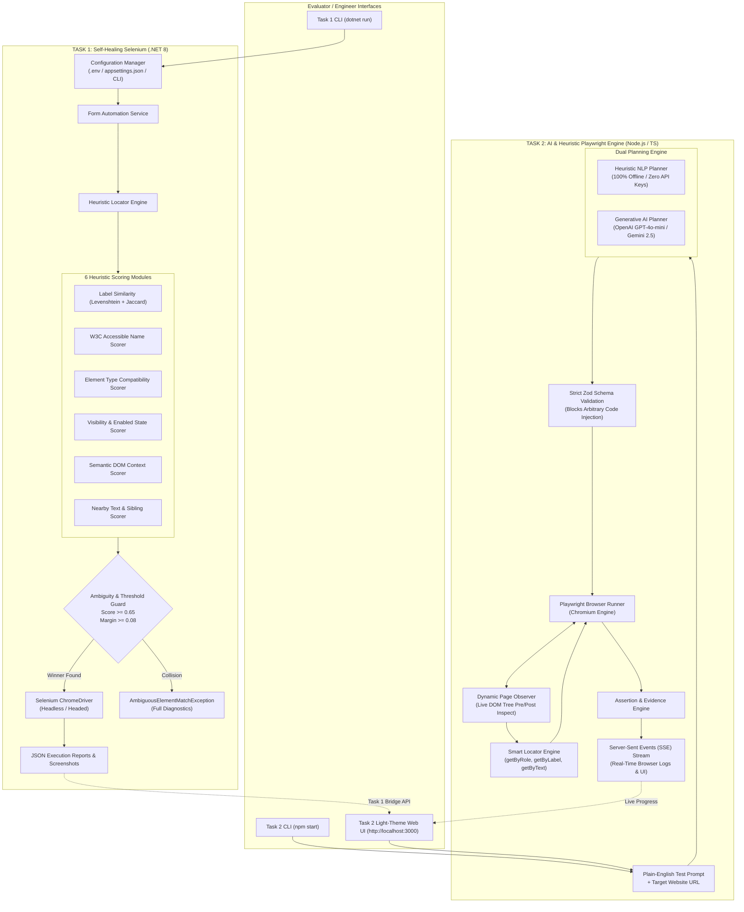
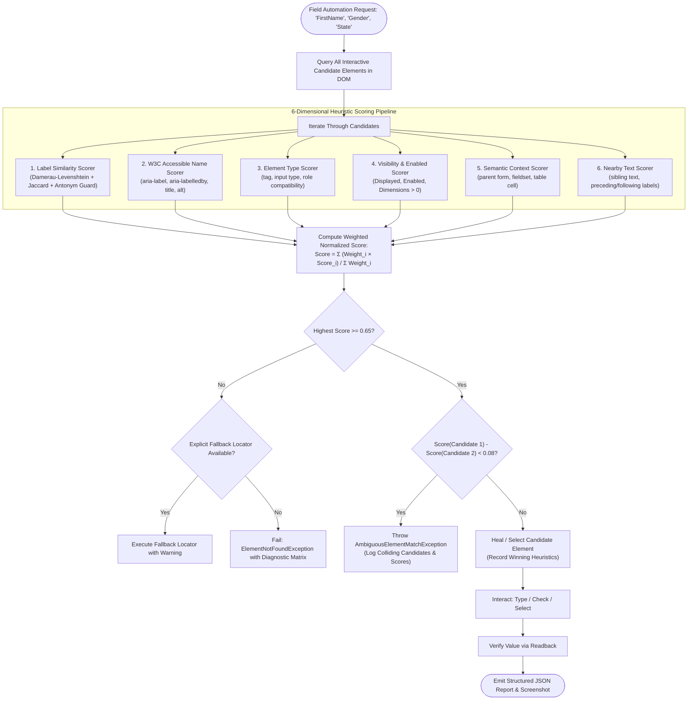
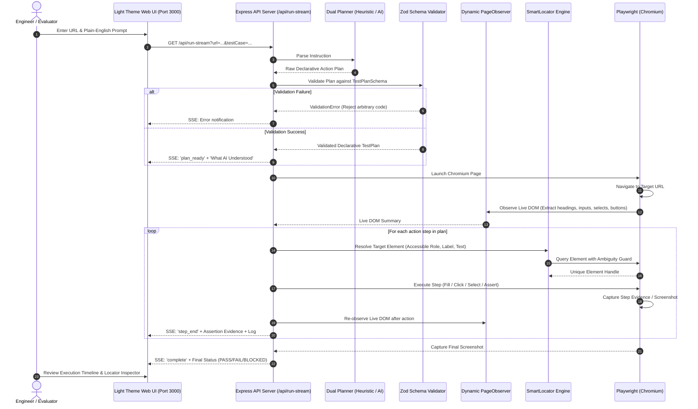

# System Architecture & Technical Design

## CloudQA Internship Assignment – Intelligent Test Automation

This document provides a technical specification and architecture blueprint for both automation frameworks developed for the CloudQA internship assignment:
1. **Task 1: Self-Healing Web Automation Using C# & Selenium**
2. **Task 2: AI & Heuristic-Powered Plain-English Browser Automation Using TypeScript & Playwright**

---

## 1. High-Level System Architecture



---

## 2. Task 1: Self-Healing Selenium Architecture

### 2.1 Core Problem Statement
Traditional test automation frameworks rely on rigid CSS selectors or brittle XPaths (e.g. `//input[@id='fname']`). Any minor UI refactoring—such as ID renaming, class restyling, or element reordering—breaks the test suite.

The **Self-Healing Selenium Framework** eliminates selector fragility by evaluating candidate DOM elements against a multi-heuristic scoring engine.



### 2.2 Mathematical Confidence Scoring Formulation

For each candidate element $e \in \text{DOM}$ and target field specification $F$:

$$\text{Confidence}(e, F) = \frac{\sum_{i=1}^{6} w_i \cdot S_i(e, F)}{\sum_{i=1}^{6} w_i}$$

| Heuristic Scorer | Weight ($w_i$) | Description & Signals Evaluated |
|:---|:---:|:---|
| **Label Similarity** | `3.0` | Damerau-Levenshtein edit distance + Jaccard token overlap on `<label for="...">` and enclosing label text. Penalizes antonyms (e.g. `First Name` vs `Last Name`). |
| **Accessible Name** | `2.5` | Standard W3C accessible name computation: `aria-labelledby`, `aria-label`, `title`, `alt`, and `placeholder`. |
| **Element Type Compatibility** | `2.0` | Compatibility check between requested target type (`Textbox`, `RadioGroup`, `SelectDropdown`) and the candidate tag/attributes (`<input type="text">`, `<select>`, `<input type="radio">`). |
| **Visibility & Enabled** | `1.5` | Physical rendering check: `Displayed == true`, `Enabled == true`, element bounding box dimensions $> 0 \times 0$. |
| **Semantic Context** | `1.0` | Evaluates proximity to enclosing semantic containers (`<form>`, `<fieldset>`, `<legend>`, table rows, and grid columns). |
| **Nearby Text / Siblings** | `1.0` | Proximity scoring on immediately preceding or following sibling elements containing field keywords. |

### 2.3 Ambiguity Collision Resolution
Unlike naive self-healing algorithms that pick the first element above a threshold, this framework strictly enforces an **Ambiguity Guard**:

$$\Delta = \text{Score}(\text{Winner}) - \text{Score}(\text{RunnerUp})$$

If $\Delta < \tau_{\text{ambiguity}}$ (default $0.08$), the engine refuses to guess randomly. It halts execution and generates an `AmbiguousElementMatchException` containing detailed diagnostics for both colliding candidates.

---

## 3. Task 2: AI & Heuristic Playwright Engine Architecture

### 3.1 Dual-Engine Architecture (Generative AI + Offline Deterministic NLP)
Task 2 accepts arbitrary natural language test instructions and translates them into safe, declarative test steps. It features a **Dual-Engine Planner**:
1. **Generative AI Engine**: Calls OpenAI GPT-4o-mini or Google Gemini with JSON Schema constraints.
2. **Heuristic NLP Engine**: A token-based deterministic rule engine that runs completely offline with zero API keys and 100% test pass fidelity.



### 3.2 Security Boundary: Zod Declarative Whitelist
To prevent Prompt Injection and arbitrary code execution attacks, the system never passes LLM-generated code into `eval()`, `page.evaluate()`, or terminal shells.

All generated plans must validate against a strict discriminated union schema:
- **Whitelisted Actions**: `navigate`, `click`, `fill`, `select`, `check`, `uncheck`, `press`, `wait_for`, `assert_visible`, `assert_text`, `assert_url`, `extract`.
- **Target Locators**: Restricted to semantic criteria (`role`, `name`, `text`, `label`, `placeholder`, `selector`).
- **Arbitrary JS Rejection**: Any plan containing unknown action verbs or script injections is immediately rejected before touching the browser.

---

## 4. Cross-Project Architecture Matrix

| Architectural Feature | Task 1: Self-Healing Selenium | Task 2: AI & Heuristic Playwright |
|:---|:---|:---|
| **Language & Runtime** | C# (.NET 8.0) | TypeScript / Node.js (v18+) |
| **Browser Driver** | Selenium WebDriver 4.28 + ChromeDriver | Playwright Chromium (Automated Driver) |
| **Primary Input** | Target URL + Field values via Config / CLI | Natural language test sentence + Target URL |
| **Locator Strategy** | Multi-heuristic weighted scoring matrix | W3C semantic locators (`getByRole`, `getByLabel`, etc.) |
| **Self-Healing Trigger** | Reordered DOM, mutated IDs, changed CSS | Live DOM tree observation & semantic fallback chain |
| **Ambiguity Prevention** | Mathematical score delta check ($\Delta < 0.08$) | Single-element count check + Ambiguity reporting |
| **Test Assertions** | NUnit 4 assertions + value readback | Strict Playwright assertions (`toBeVisible`, `toHaveText`) |
| **Reporting Output** | Structured JSON report + Step screenshots | JSON report + Colored CLI + Light-Theme Web UI |
| **External AI Dependency** | **Zero (100% deterministic local algorithms)** | **Hybrid (Zero for heuristic engine; optional for AI)** |

---

## 5. Directory Layout Blueprint

```
ColudQA/
├── ARCHITECTURE.md                  # Comprehensive architectural specification (this file)
├── README.md                        # Master repository documentation with quickstarts
├── .env                             # Unified environment configuration
├── .env.example                     # Environment template
├── .gitignore                       # Master git ignore configuration
│
├── Task1-SelfHealing-Selenium/      # C# .NET 8 Self-Healing Automation Project
│   ├── .env                         # Task 1 environment configuration
│   ├── .env.example                 # Task 1 environment template
│   ├── .gitignore                   # Task 1 git ignore
│   ├── README.md                    # Deep-dive Task 1 documentation
│   ├── Task1-SelfHealing-Selenium.sln # .NET 8 Solution
│   ├── appsettings.json             # Structured application settings
│   ├── src/SelfHealingSelenium/     # Core C# source code
│   │   ├── Configuration/           # Strongly-typed config manager & options
│   │   ├── Locators/                # Locator engine & 6 scoring modules
│   │   ├── Models/                  # Candidate elements & report models
│   │   ├── Services/                # Form automation, reporting, & screenshot services
│   │   ├── Utilities/               # Levenshtein & Jaccard similarity algorithms
│   │   └── Program.cs               # Console CLI entrypoint
│   └── tests/SelfHealingSelenium.Tests/ # 11 NUnit unit & integration tests
│       ├── AmbiguityDetectionTests.cs
│       ├── ScoringTests.cs
│       ├── MutatedDomIntegrationTests.cs
│       ├── LiveCloudQaIntegrationTests.cs
│       └── Fixtures/                # Mutated DOM test HTML fixtures
│
└── Task2-AI-Test-Automation/        # AI & Heuristic Playwright Automation Project
    ├── .env                         # Task 2 environment configuration
    ├── .env.example                 # Task 2 environment template
    ├── .gitignore                   # Task 2 git ignore
    ├── README.md                    # Deep-dive Task 2 documentation
    ├── package.json                 # NPM scripts & dependencies
    ├── tsconfig.json                # TypeScript compiler configuration
    ├── frontend/                    # Light-theme Web UI
    │   └── index.html               # Single-page Test Studio & History comparison
    ├── src/                         # Core TypeScript source code
    │   ├── config/                  # Environment & runtime configuration
    │   ├── executor/                # Playwright execution engine
    │   ├── locators/                # Smart locator resolution & disambiguation
    │   ├── observation/             # Dynamic live DOM observer
    │   ├── planner/                 # AI (OpenAI/Gemini) & Heuristic NLP planners
    │   ├── reporting/               # Execution report generator
    │   ├── server/                  # Dual-stack Express API with SSE streaming
    │   ├── validation/              # Strict Zod declarative action schemas
    │   └── cli.ts                   # CLI entrypoint
    ├── tests/                       # 19 Playwright verification tests
    │   └── test_runner.ts           # 6 technical audit test suites
    ├── reports/                     # Persisted execution JSON reports
    └── screenshots/                 # Captured browser state screenshots
```

