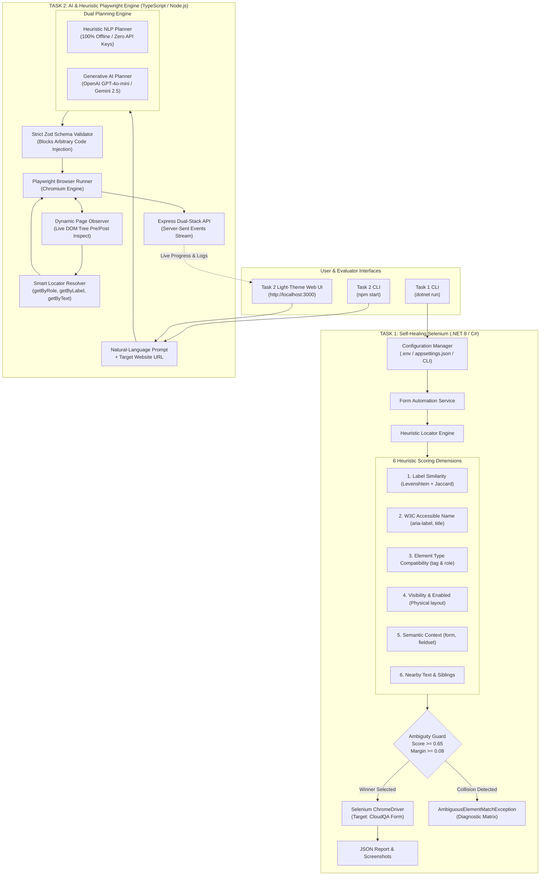

# CloudQA Internship Assignment – Intelligent Test Automation

[](https://dotnet.microsoft.com/)
[](https://www.selenium.dev/)
[](https://www.typescriptlang.org/)
[](https://playwright.dev/)
[](https://zod.dev/)
[](#test-verification-summary)

This repository contains two production-ready, independent automation projects developed for the **CloudQA Intelligent Test Automation Internship Assignment**:

1. **`Task1-SelfHealing-Selenium/`**: Self-Healing Web Automation in **C# (.NET 8)** using **Selenium WebDriver**, **ChromeDriver**, and **NUnit**. It implements an intelligent multi-heuristic locator engine that tolerates reordered fields, mutated IDs, and changing CSS classes with ambiguity collision detection.
2. **`Task2-AI-Test-Automation/`**: Generic AI & Heuristic-Powered Browser Automation in **TypeScript**, **Node.js**, and **Playwright**. It accepts plain-English natural language instructions, generates strict declarative action plans guarded by **Zod**, and features dynamic live-DOM observation alongside a light-theme Web UI.

---

## 🏛️ System Architecture Diagram



> 📖 **Deep Dive**: For full mathematical formulas, scoring weights, and sequence diagrams, see [ARCHITECTURE.md](ARCHITECTURE.md).

---

## 📂 Repository Structure

```
ColudQA/
├── ARCHITECTURE.md                  # Comprehensive architectural specification & diagrams
├── README.md                        # Master repository documentation (this file)
├── .env                             # Unified environment variables for both tasks
├── .env.example                     # Unified environment template
├── .gitignore                       # Master Git ignore rules
│
├── Task1-SelfHealing-Selenium/      # TASK 1: C# .NET 8 Self-Healing Automation
│   ├── src/SelfHealingSelenium/     # Console CLI, Heuristic Engine, 6 Scorers, Services
│   │   ├── Configuration/           # Strongly-typed configuration manager
│   │   ├── Locators/                # Scoring modules & locator engine
│   │   ├── Models/                  # Candidate elements & step result models
│   │   ├── Services/                # Form automation, reporting, & screenshots
│   │   ├── Utilities/               # Damerau-Levenshtein & Jaccard algorithms
│   │   └── Program.cs               # CLI entrypoint
│   ├── tests/SelfHealingSelenium.Tests/ # 11 NUnit unit & integration tests
│   │   ├── AmbiguityDetectionTests.cs
│   │   ├── ScoringTests.cs
│   │   ├── MutatedDomIntegrationTests.cs
│   │   ├── LiveCloudQaIntegrationTests.cs
│   │   └── Fixtures/                # Mutated DOM test HTML fixtures
│   ├── appsettings.json             # Structured application settings
│   ├── .env                         # Task 1 local environment configuration
│   ├── .env.example                 # Task 1 environment template
│   └── README.md                    # Dedicated Task 1 documentation
│
└── Task2-AI-Test-Automation/        # TASK 2: AI & Heuristic Playwright Engine
    ├── src/
    │   ├── config/                  # Environment and execution settings
    │   ├── executor/                # Playwright execution engine with runtime variables
    │   ├── locators/                # Semantic locator resolution with ambiguity guard
    │   ├── observation/             # Dynamic live-DOM tree pre/post inspector
    │   ├── planner/                 # AI (OpenAI/Gemini) & Offline Heuristic NLP planners
    │   ├── reporting/               # Structured report generator
    │   ├── server/                  # Express REST & SSE streaming server (port 3000)
    │   ├── validation/              # Strict Zod declarative action schema
    │   └── cli.ts                   # Command-line test runner
    ├── tests/                       # 19 Playwright verification tests across 6 suites
    │   └── test_runner.ts           # Test runner covering all audit criteria
    ├── frontend/                    # Light-theme Web UI (Test Studio & History)
    │   └── index.html               # Single-page interface with inline validation & animations
    ├── package.json                 # NPM dependencies and scripts
    ├── tsconfig.json                # TypeScript compiler configuration
    ├── .env                         # Task 2 local environment configuration
    ├── .env.example                 # Task 2 environment template
    └── README.md                    # Dedicated Task 2 documentation
```

---

## ⚡ Quick Start & Verification Summary

### TASK 1: Self-Healing Web Automation (C# / .NET 8)

Targets: `https://app.cloudqa.io/home/AutomationPracticeForm`
Automated Fields:
1. **First Name** – Textbox (`Abhishek`)
2. **Gender** – Radio Group (`Male`)
3. **State** – Dropdown (`United States`)

#### Run CLI Automation
```bash
cd Task1-SelfHealing-Selenium

# Run against live CloudQA practice form (headless by default)
dotnet run --project src/SelfHealingSelenium/SelfHealingSelenium.csproj

# Run in visible browser mode with custom target
dotnet run --project src/SelfHealingSelenium/SelfHealingSelenium.csproj -- --headless=false --name="Abhishek" --gender="Male" --state="United States"
```

#### Run All 11 NUnit Tests
```bash
cd Task1-SelfHealing-Selenium
dotnet test tests/SelfHealingSelenium.Tests/SelfHealingSelenium.Tests.csproj
```
**Test Results**: `Passed! - Failed: 0, Passed: 11, Skipped: 0 (100% Pass Rate)`
- `ScoringTests.cs`: Validates individual heuristic scorers and antonym rejection.
- `AmbiguityDetectionTests.cs`: Confirms framework refuses to guess on close scores ($\Delta < 0.08$) and raises `AmbiguousElementMatchException`.
- `MutatedDomIntegrationTests.cs`: Proves resilience against reordered fields and scrambled IDs/classes.
- `LiveCloudQaIntegrationTests.cs`: Live browser test against the actual CloudQA website.

---

### TASK 2: AI & Heuristic Playwright Automation (TypeScript / Node.js)

Accepts any generic natural language instruction and executes it in real browser sessions.

#### 1. Install Dependencies
```bash
cd Task2-AI-Test-Automation
npm install
```

#### 2. Run Comprehensive Test Suite (19 Tests Across 6 Scenarios)
```bash
cd Task2-AI-Test-Automation
npm test
```
**Test Results**: `19 Passed, 0 Failed (100% Pass Rate)`:
- **Suite 1: Zod Schema & Security Boundaries**: Blocks arbitrary JavaScript injection.
- **Suite 2: Generic NLP Test Planning**: Validates unseen natural language conversion.
- **Suite 3: Generic Website Execution**: Verifies `https://example.com` text assertions.
- **Suite 4: Local Login Fixture**: End-to-end authentication and customer dashboard verification.
- **Suite 5: Negative Testing**: Confirms element-not-found failure detection, diagnosis, and screenshot capture.
- **Suite 6: PHPTRAVELS Customer Demo Flow**: Real browser exploration of dynamic demo access.

#### 3. Run Command-Line Automation
```bash
cd Task2-AI-Test-Automation
npm start -- --url="https://example.com" --test="Navigate to https://example.com and assert text 'documentation examples' is visible"
```

#### 4. Launch the Light-Theme Web UI
```bash
cd Task2-AI-Test-Automation
npm run server
```
Open **[http://localhost:3000](http://localhost:3000)** in your browser:
- **Inline URL Validation**: Real-time URL format check with animated validation pills.
- **Scenario Presets**: One-click execution cards for Generic Web, Auth Fixture, PHPTRAVELS, Negative Test, Unseen Flow, and Navigation.
- **What AI Understood**: Structured breakdown of intent, entities, outcomes, runtime data, and obstacle mitigations.
- **Vertical Execution Timeline**: Step-by-step progress with radar pulses on running steps and bounce checks on passed steps.
- **Locator Inspector**: Full inspection of accessible roles, element counts, locator strategies, and Task 1 scoring bridge data.
- **Assertion Explorer & Screenshot Preview**: Interactive proof viewer with zoom and full-screen modal.
- **Test History & Side-by-Side Comparison**: Persisted execution archive with multi-run diff comparisons.

---

## 🛡️ Key Engineering Highlights

### 1. Dual-Engine Architecture (Not Solely Dependent on AI)
- While the system includes genuine LLM integration (OpenAI `gpt-4o-mini` and Google Gemini `gemini-2.5-flash`), it also includes an **Offline Heuristic NLP Planner** ([`heuristicPlanner.ts`](file:///c:/Users/Asus/Downloads/ColudQA/Task2-AI-Test-Automation/src/planner/heuristicPlanner.ts)).
- The system operates with **100% reliability even when completely offline or without external API keys**, making it ideal for deterministic CI/CD environments.

### 2. Multi-Dimensional Confidence Scoring (Task 1)
- Avoids fragile XPaths by combining:
  1. Label similarity (Levenshtein + Jaccard distance with antonym safeguards).
  2. W3C accessible name matching (`aria-label`, `aria-labelledby`, `title`, `placeholder`).
  3. Element type compatibility matrix.
  4. Physical layout and visibility metrics.
  5. Semantic DOM hierarchy (enclosing forms, fieldsets, tables).
  6. Nearby sibling text.

### 3. Ambiguity Collision Guard
- If two candidate elements score within $\Delta = 0.08$ of each other, the engine throws `AmbiguousElementMatchException` with complete candidate diagnostics rather than guessing randomly.

### 4. Zero Arbitrary Code Injection
- The system never passes LLM-generated code into `eval()` or `page.evaluate()`.
- Plans are restricted to 12 declarative Playwright actions validated against a strict Zod discriminated union schema.

---

## ⚙️ Environment Variables Reference

Both tasks can be configured using `.env` files:

```env
# ==============================================================================
# Unified Configuration (.env)
# ==============================================================================

# TASK 1: C# Self-Healing Selenium
TARGET_URL=https://app.cloudqa.io/home/AutomationPracticeForm
FIRST_NAME=Abhishek
GENDER=Male
STATE=United States
HEADLESS=true
MIN_CONFIDENCE=0.65
AMBIGUITY_MARGIN=0.08

# TASK 2: AI & Heuristic Playwright Engine
LLM_PROVIDER=heuristic       # 'heuristic' (offline), 'gemini', or 'openai'
GEMINI_API_KEY=your_key_here # Optional
OPENAI_API_KEY=your_key_here # Optional
HEADLESS=true
BROWSER_TIMEOUT=20000
PORT=3000
```

---

## 👨‍💻 Author & Submission

- **Candidate**: Abhishek Choudhary
- **Assignment**: CloudQA Internship Assignment – Intelligent Test Automation
- **GitHub Repository**: [https://github.com/Abhishekchoudhary9622/CloudQA](https://github.com/Abhishekchoudhary9622/CloudQA)
